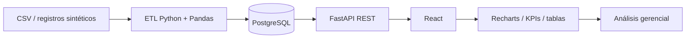
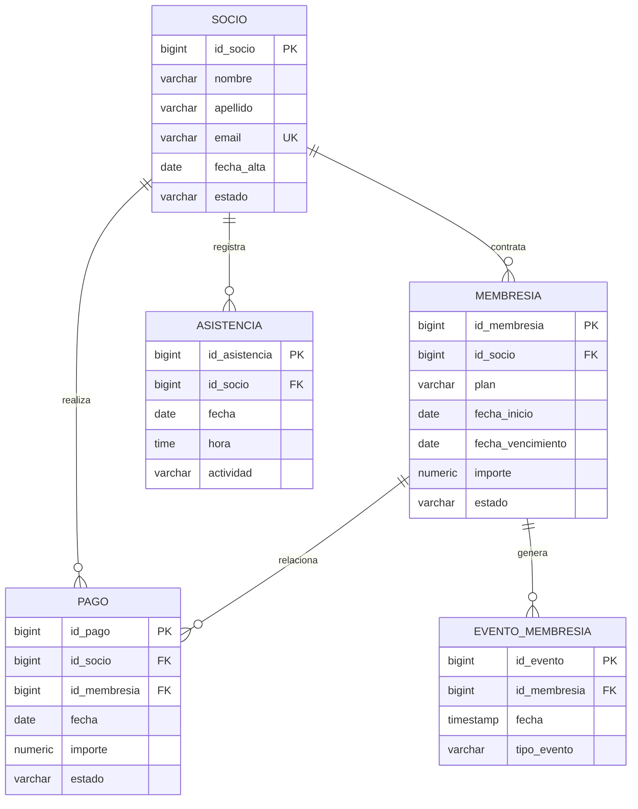

# Arquitectura y diseño técnico

## Vista lógica

## Responsabilidades

- **Frontend React:** navegación, filtros, tarjetas KPI, tablas y gráficos responsive. No contiene fórmulas analíticas autoritativas.
- **FastAPI:** valida parámetros, coordina consultas y expone contratos JSON.
- **Pandas:** normaliza series temporales y procesa el archivo CSV de socios; informa duplicados y filas inválidas.
- **PostgreSQL:** persiste socios, membresías, asistencias, pagos y eventos de membresía con claves foráneas.

## Modelo relacional simplificado

## Flujo de consulta

1. Gerencia selecciona un período en el frontend.
2. React envía las fechas a `GET /api/dashboard`.
3. FastAPI valida que la fecha inicial no supere la final.
4. SQL calcula conteos y sumas sobre PostgreSQL; Pandas completa la serie temporal diaria.
5. La API devuelve un JSON único para tarjetas y gráficos.
6. React representa los resultados con Recharts.

## Seguridad pendiente para producción

El documento académico contempla RBAC, hash de credenciales Argon2id, HTTPS/TLS, variables de entorno y respaldos. Esta entrega ejecutable implementa la separación de capas y utiliza variables de entorno para la conexión, pero no incluye todavía un módulo de autenticación/RBAC ni despliegue TLS. No se debe considerar lista para producción.
